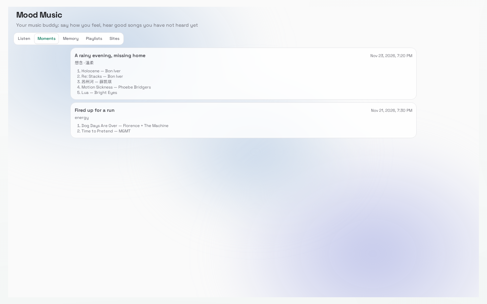

# Mood Music

<picture>
  <source media="(prefers-color-scheme: dark)" srcset="docs/media/hero-dark.png">
  
</picture>

**Say how you feel, and hear songs that feel the same.**

Mood Music is an app for [Kiro Crew](https://github.com/kirodotdev/KiroCrew),
the open-source personal AI agent.

## What it is

Mood Music adds a **Mood Music** page to Kiro Crew. You tell your music buddy how
you feel, or name a song that moved you. The buddy searches reviews and lists for
good songs most people have not heard yet, says why each one fits and what to listen
for, and orders them from staying with the feeling to lifting it a little. You see
what it is doing while it works. Every link is checked before it is shown. YouTube
songs play right on the page; bilibili songs open in a new tab of your own browser.
A **Memory** tab shows what the buddy knows about your taste, and you decide what
stays.

**Get started:** open **Apps → Discover**, find **Mood Music**, choose **Install**,
then **Enable**. See [Install](#install) for the details.

## The problem it solves

Music apps pick songs from your history and from genres. They do not ask how you
feel. When one song hits you hard, there is no simple way to say "more of this
feeling" and to hear why each song was picked. Mood Music starts from the feeling,
and it remembers what you liked and skipped so the next picks get closer. It never
signs in to any music site and never plays, likes or comments anything for you.

## Top 3 use cases

### 1. Find songs for a mood

It is a rainy evening and you miss home. You click **Missing someone**, or type it
in your own words. A moment later a song is ready to play, with a short line on why
it fits, and more songs wait under **Up next**. Click **Like** on the ones that land.


### 2. Open a bilibili pick in your own browser

Some picks live on bilibili. Mood Music shows **Open on bilibili**, and the song
opens in a new tab of your own browser, signed in or not, as you prefer. Click
**More like this** to get songs close to the one you are hearing.


### 3. Look back at your moments

Every mood you share is kept on the **Moments** tab, with the time and the songs it
brought. It is a small diary of what you felt and what you listened to.



The background colour and its slow drift follow the mood, in light and dark:


## Watch it


[Watch the walkthrough as a video (MP4)](docs/media/walkthrough.mp4).

<sub>Recorded from the Mood Music page drawn with Kiro Crew's own dashboard styles on
made-up demo data. No AI model was connected: the DJ's reply was written for this
demo, so a real reply will differ, and the wait for it is shortened. The YouTube
player is shown as a stand-in frame.</sub>

## Install

**From the Kiro Crew App Store**

1. In Kiro Crew, open **Apps → Discover** in the left sidebar.
2. Search for **Mood Music** and choose **Install**.
3. Kiro Crew asks **Trust “Mood Music” to run its own code?** The app runs a small
   piece of code that saves your moods and likes on your computer. Trusting it gives
   that code the same access Kiro Crew has (your files, your saved sign-ins and the
   internet), as the dialog says. Choose **Trust this app**. You can take it back
   later in **Settings → Security → Third-party apps**.
4. The app installs switched off. Choose **Enable and allow chat control** on its
   page, so the buddy can ask you on the Mood Music page before it opens a web page
   it was not already allowed to. It then shows up under **Apps** in the sidebar and
   in **Apps → Library**.

Kiro Crew must already be able to chat: if ordinary chats work, this works. No music
account or key is needed. Playing YouTube songs inside the page needs a Kiro Crew
that lets apps declare the video player they show; on an older Kiro Crew the player
area stays blank, and the bilibili links and everything else still work.

## First run

The page opens with a short hello from the buddy and an empty player. Type a
feeling or a song name in the box and choose **Send**, or click one of the mood
chips: a chip starts the search by itself. The conversation is also listed in the
Kiro Crew sidebar under the app's folder.

## How to use it

1. Open **Mood Music** in the sidebar.
2. Choose how far to explore: **More familiar**, **Balanced** (one song you may
   know and four new ones) or **Explore more**. To stay with a feeling, turn on
   **Just stay in this feeling today**.
3. Type how you feel, or a song that moved you, and choose **Send**, or click a mood
   chip such as **Calm** or **Missing someone**. A line under the chat says what the
   buddy is doing: thinking, searching, reading reviews, writing, or checking that
   each song plays. **Stop** cancels it.
4. Each song card says why it is here, what to listen for and who praised it. Choose
   **Play**, the heart to like it, skip, or **I know it**. Tap a suggestion under the
   reply to keep talking, or **Remember: ...** to save a preference the buddy heard.
5. Click any song under **Up next** to play it now.
6. Open **Memory** to see your own notes and the songs and moods the app recorded.
   Add, edit, pin or delete any of them; **Clear everything out of date** removes
   what the app recorded and has not used for 90 days. What you wrote yourself is
   never removed for you.
7. Open **Moments** to see the moods you shared and the songs they brought.
8. **Show the full record** under the chat opens the whole conversation, with every
   search and page the buddy used.
9. To stop the background moving, choose **Pause background motion** at the top
   right. It pauses only the background, never the music.

## Settings & data

- **Where your data lives:** `~/.kiro/crew/apps/mood-music/data/state.json` (or under
  `$KIROCREW_HOME` if you set it). It holds your moods, the current list, your likes
  and skips, and the Memory tab.
- **What leaves your computer:** your mood text and a short summary of your memory
  (your notes, songs you liked, skipped or know, recent moods) go to the AI model
  Kiro Crew uses, so the buddy can pick. The buddy searches the public web. To check
  each song, the app asks `www.youtube.com/oembed` or `api.bilibili.com` about that
  one video, with no cookie. YouTube songs load from `www.youtube-nocookie.com`, YouTube's
  privacy-enhanced player. bilibili songs open on bilibili in your own browser. Your
  moods are not saved into Kiro Crew's memory.
- **Turn it off:** **Apps → Library**, open the **⋯** menu on Mood Music, choose
  **Disable**. Your data is kept.
- **Remove it:** the same menu, **Uninstall**. **Keep app data** is ticked by
  default; untick it to delete the data too.

## Troubleshooting / FAQ

**I see "Couldn't read your buddy's answer" or "Something went wrong this time".**
Choose **Ask again** or **Try again**. **Show the full record** shows what happened.

**I see "Your buddy seems stuck".**
Nothing moved for two minutes. Choose **Wait a bit more**, or **Stop and start
over**. Check that an ordinary chat in Kiro Crew still answers.

**A message says some songs were left out, or none of them could play.**
The app asks YouTube or bilibili about every song before showing it, and drops one
that they say does not exist or whose title does not match. When they cannot be
asked (for example, bilibili refuses the check from some networks, or the check
times out), the song stays and its card says **Not verified**. Try another direction.

**The player area is blank.**
Your Kiro Crew does not yet let apps show the YouTube player. Update Kiro Crew. The
bilibili songs still open in your browser.

**Can it play Spotify or Apple Music?**
No. It plays YouTube songs on the page and opens bilibili songs in your browser.

## Development

### Layout

| Path | What it is |
|---|---|
| `app.json` | The manifest: page, agent, skill, backend hook, `ui.frameSources` |
| `agents/dj.json`, `skills/mood-music/` | The music buddy agent (`web_search` and `web_fetch` only, both run without asking) and its reply contract; the page also sends the contract and a bounded memory summary with every request (`ui/src/request.prompt.ts`) |
| `backend/` | Routes (`hooks.routes`), the JSON store with memory, the link checks, and `verify.py` (the YouTube oEmbed / bilibili view lookups) |
| `ui/src/`, `ui/dist/index.mjs` | The page, and its committed ESM bundle |
| `ui/i18n/` | The app's strings in 12 languages |
| `tests/`, `ui/tests/` | Backend and UI tests |

The page plays YouTube in a sandboxed iframe on
`https://www.youtube-nocookie.com/embed/<id>`, built from an 11-character video id
the page and the backend both check. `ui.frameSources` declares that one origin; a
Kiro Crew with the app frame-source seam adds it to the dashboard's `frame-src` while
the app is enabled and trusted. bilibili links must be `https` on exactly
`www.bilibili.com`, `m.bilibili.com` or `b23.tv`.

### Install from a clone

```bash
git clone https://github.com/iamwhatever/kirocrew-app-mood-music
kirocrew app install ./kirocrew-app-mood-music
kirocrew app enable mood-music
```

`kirocrew app enable` is refused with `app_execution_denied` until the app is
trusted, and there is no command-line trust step. Enable it from **Apps → Library**
instead: that opens the trust dialog, and **Trust this app and enable** does both.
`kirocrew app disable mood-music` turns it off;
`kirocrew app uninstall mood-music` keeps the data and adding `--purge-data`
deletes it.

### Tests

```bash
python -m pip install -r tests/requirements.txt
python -m pytest
cd ui && npm ci && npm run typecheck && npm test && npm run build
```

CI fails if `ui/dist/` differs from a fresh build.

### Re-capture the README media

The pictures and the recording above were drawn from the page with demo data and a
stand-in player. [`capture/`](capture/README.md) holds the template's harness for a
real, isolated Kiro Crew gateway:

```bash
python capture/capture.py --kirocrew /path/to/KiroCrew
python capture/check_readme.py
```

Then look at every image and at a few frames of the video before committing
(see [CHECKLIST.md](CHECKLIST.md)).

## License

Apache License 2.0. See [LICENSE](LICENSE) and [NOTICE](NOTICE).
