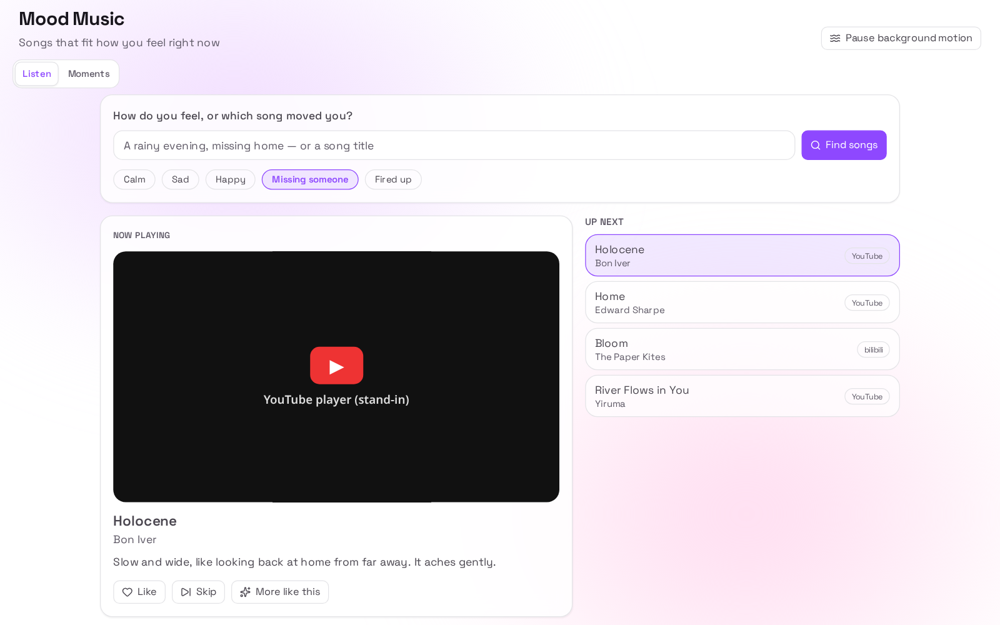
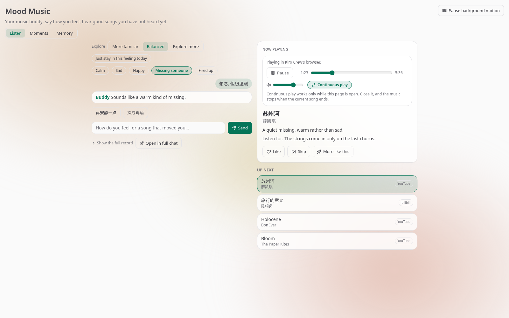
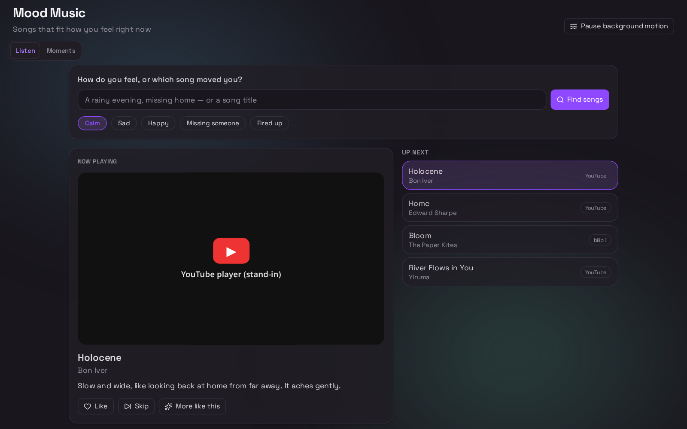

# Mood Music

<picture>
  <source media="(prefers-color-scheme: dark)" srcset="docs/media/hero-dark.png">
  
</picture>

**Say how you feel, and hear songs that feel the same.**

Mood Music is an app for [Kiro Crew](https://github.com/kirodotdev/KiroCrew),
the open-source personal AI agent.

## What it is

Mood Music adds a **Mood Music** page to Kiro Crew. You tell your music buddy how
you feel, or name a song that moved you. The buddy searches reviews and lists for
good songs most people have not heard yet, says why each one fits and what to listen
for, and orders them from staying with the feeling to lifting it a little. You see
what it is doing while it works. Songs play in Kiro Crew's own browser: press play,
and the buddy finds the song on YouTube or bilibili there and starts it. A
**Memory** tab shows what the buddy knows about your taste, and you decide what
stays.

**Get started:** open **Apps → Discover**, find **Mood Music**, choose **Install**,
then **Enable**. See [Install](#install) for the details.

## The problem it solves

Music apps pick songs from your history and from genres. They do not ask how you
feel. When one song hits you hard, there is no simple way to say "more of this
feeling" and to hear why each song was picked. Mood Music starts from the feeling,
and it remembers what you liked and skipped so the next picks get closer. It never
signs in to any music site and never plays, likes or comments anything for you.

## Top 3 use cases

### 1. Find songs for a mood

It is a rainy evening and you miss home. You click **Missing someone**, or type it
in your own words. A moment later a song is ready to play, with a short line on why
it fits, and more songs wait under **Up next**. Click **Like** on the ones that land.


### 2. Let the buddy play songs in Kiro Crew's browser

Choose **Find and play** (or a song's play button), and the buddy searches for it on
bilibili or YouTube in Kiro Crew's own browser and opens the video. That is the same
browser your chats use; on a Mac it is your own Chrome, with your sign-ins and your
sound. The buddy plays every song in one tab of its own. **Play**, **Pause**, the
progress bar and the volume act on that tab at once; they never wait for the buddy.
**Continuous play** is on from the start: when a song ends the buddy plays the next
one, adding songs for the same mood when the list runs low, until you press
**Pause**. Turn it off and the page remembers. Click **More like this** to get songs
close to the one you are hearing.

The first time, approve the music sites on the app's page (**Approve the sites**
takes you there). Mood Music may only open bilibili and YouTube search and video
pages. Continuous play works only while the Mood Music page is open: close it and the
music stops when the current song ends.

Above the player, **Kiro Crew's browser** shows the buddy's browser tab live, the same
picture a chat shows under a browser step. The line beside it says **Using the
browser…** while the buddy searches and opens the song. Choose **Take over** to use
the tab yourself and **Hand back** when you are done; **Hide** folds the box away and
the page remembers. The box keeps showing the tab after the buddy finishes, on a
Kiro Crew whose browser view can stay live; an older one shows **Show live page**
instead, and one click streams the tab again. This needs a Kiro Crew with the app browser view (KiroCrew#39246,
#39018, #39020), **App browser access** on in **Settings → Feature Previews**, and
**view** approved on the app's page. On an older Kiro Crew the box says to update.



<sub>This picture and the one at the top were drawn from the page with made-up songs
and a made-up browser tab state (playing, 1:23 of 5:36); no real browser tab or model
was used.</sub>

### 3. Look back at your moments

Every mood you share is kept on the **Moments** tab, with the time and the songs it
brought. It is a small diary of what you felt and what you listened to.


The background colour and its slow drift follow the mood, in light and dark:




## Watch it


[Watch the walkthrough as a video (MP4)](docs/media/walkthrough.mp4).

<sub>Recorded from the Mood Music page drawn with Kiro Crew's own dashboard styles on
made-up demo data, before version 0.2.5. No AI model was connected: the DJ's reply was
written for this demo, so a real reply will differ, and the wait for it is shortened.
The recording still shows the old in-page player and bilibili link; since 0.2.5 songs
play only in Kiro Crew's browser.</sub>

## Install

**From the Kiro Crew App Store**

1. In Kiro Crew, open **Apps → Discover** in the left sidebar.
2. Search for **Mood Music** and choose **Install**.
3. Kiro Crew asks **Trust “Mood Music” to run its own code?** The app runs a small
   piece of code that saves your moods and likes on your computer. Trusting it gives
   that code the same access Kiro Crew has (your files, your saved sign-ins and the
   internet), as the dialog says. Choose **Trust this app**. You can take it back
   later in **Settings → Security → Third-party apps**.
4. The app installs switched off. Choose **Enable and allow chat control** on its
   page, so the buddy can ask you on the Mood Music page before it opens a web page
   it was not already allowed to. It then shows up under **Apps** in the sidebar and
   in **Apps → Library**.

Kiro Crew must already be able to chat: if ordinary chats work, this works. No music
account or key is needed. Playing songs needs a Kiro Crew that lets apps name the
browser pages their agent may open (KiroCrew#38333, newer than v0.13.0-rc.3). On an
older Kiro Crew the page says so in the player's place and offers no play button;
finding songs, Moments and Memory still work.

## First run

The page opens with a short hello from the buddy and an empty player. Type a
feeling or a song name in the box and choose **Send**, or click one of the mood
chips: a chip starts the search by itself. On a wide window the chat is on the left,
and the browser, the player and **Up next** are on the right. The conversation stays
on this page; it is not listed in Kiro Crew's sessions.

## How to use it

1. Open **Mood Music** in the sidebar.
2. Choose how far to explore: **More familiar**, **Balanced** (one song you may
   know and four new ones) or **Explore more**. To stay with a feeling, turn on
   **Just stay in this feeling today**.
3. Type how you feel, or a song that moved you, and choose **Send**, or click a mood
   chip such as **Calm** or **Missing someone**. A line under the chat says what the
   buddy is doing: thinking, searching, reading reviews, writing, or checking that
   each song plays, with its steps in plain words (for example "Searched the web ×
   3 · Read a page"). Each reply keeps its steps. **Stop** cancels it.
4. Each song card says why it is here, what to listen for and who praised it. Choose
   **Play**, the heart to like it, skip, or **I know it**. Tap a suggestion under the
   reply to keep talking, or **Remember: ...** to save a preference the buddy heard.
5. **Up next** lists every song with its artist and why it was picked; the one
   playing says **Now playing**. Click any song to play it now.
6. Open **Memory** to see your own notes and the songs and moods the app recorded.
   Add, edit, pin or delete any of them; **Clear everything out of date** removes
   what the app recorded and has not used for 90 days. What you wrote yourself is
   never removed for you.
7. Open **Moments** to see the moods you shared and the songs they brought.
8. **Show the full record** under the chat opens the whole conversation, with every
   search and page the buddy used.
9. The background follows the mood. A chip sets its scene at once. The buddy
   picks a new scene only when your mood clearly shifts, and the scene drifts
   toward its brighter colour as the songs move from stay to lift. To stop the
   background moving, choose **Pause background motion** at the top
   right. It pauses only the background, never the music.

## Settings & data

- **Where your data lives:** `~/.kiro/crew/apps/mood-music/data/state.json` (or under
  `$KIROCREW_HOME` if you set it). It holds your moods, the current list, your likes
  and skips, and the Memory tab.
- **What leaves your computer:** your mood text and a short summary of your memory
  (your notes, songs you liked, skipped or know, recent moods) go to the AI model
  Kiro Crew uses, so the buddy can pick. The buddy searches the public web. To check
  song link the buddy gives, the app asks `www.youtube.com/oembed` or
  `api.bilibili.com` about that one video, with no cookie. Songs play on YouTube or
  bilibili in Kiro Crew's browser. Since 0.2.6 the buddy's chat is opened by the app
  with Kiro Crew's usual memory setting, so Kiro Crew's memory may learn from it as
  from any of your chats (before 0.2.6 it was a temporary chat that wrote no memory).
- **Crew Browser:** the buddy types and clicks in Kiro Crew's browser, which may be
  your own signed-in Chrome. Kiro Crew holds it to four kinds of page:
  `search.bilibili.com/all`, `www.bilibili.com/video/BV…`, `www.youtube.com/results`
  and `www.youtube.com/watch`. Its instructions forbid account pages, comments, likes,
  coins and payments, but those are rules it follows, not a block Kiro Crew enforces
  on those pages. Mood Music keeps, per site, the steps that last played a song (for
  example "open the search page, open the matching video in the same tab") in `state.json`,
  and sends them back to the buddy next time. If they fail, it forgets them and the
  buddy finds the way again.
- **The buddy's chat:** the app opens it itself (chat slots, at the trust prompt)
  and keeps it out of Kiro Crew's session lists (hidden sessions). Open it with
  **Open in full chat** on the page. Since 0.2.6 it is a new chat; the one from
  0.2.3 to 0.2.5 and the listed one from before 0.2.3 are left as they were. Mood
  Music no longer uses them and never deletes them, so close or delete them
  yourself when you like. If Kiro Crew is too old to open a hidden chat for an app,
  the page says to update it; it never opens a listed chat instead.
- **The live browser view:** only you see it, on this page. The buddy cannot read
  it, and the app asks for **view** only, never to read or act on the page itself.
- **Turn it off:** **Apps → Library**, open the **⋯** menu on Mood Music, choose
  **Disable**. Your data is kept.
- **Remove it:** the same menu, **Uninstall**. **Keep app data** is ticked by
  default; untick it to delete the data too.

## Troubleshooting / FAQ

**I see "Couldn't read your buddy's answer" or "Something went wrong this time".**
Choose **Ask again** or **Try again**. **Show the full record** shows what happened.

**I see "Your buddy seems stuck".**
Nothing moved for two minutes. Choose **Wait a bit more**, or **Stop and start
over**. Check that an ordinary chat in Kiro Crew still answers.

**A message says some songs were left out, or none of them could play.**
When the buddy gives a song's link, the app asks YouTube or bilibili about it before
showing the song, and drops one that they say does not exist or whose title does not
match. When they cannot be asked (for example, bilibili refuses the check from some
networks, or the check times out), the song stays and its card says **Not verified**.
A song with no link is kept: the buddy finds it on its site when you press play. Try
another direction.

**The player says "Songs cannot play in Kiro Crew's browser yet".**
The note says why. Your Kiro Crew is too old (update it to a version newer than
v0.13.0-rc.3 that includes KiroCrew#38333, then open the page again), the sites are
not approved yet (choose **Approve the sites**), or a policy turns Kiro Crew's
browser off. There is no play button until then.

**The buddy says it could not play a song.**
Its reason shows under the chat. Press play again: it finds the way afresh.

**Can it play Spotify or Apple Music?**
No. It plays YouTube and bilibili songs in Kiro Crew's browser.

## Development

### Layout

| Path | What it is |
|---|---|
| `app.json` | The manifest: page, agent, skill, backend hook, `permissions.chatSlots`, `hiddenSessions`, `browserSites` and `browser: ["view"]` |
| `agents/dj.json`, `skills/mood-music/` | The music buddy agent (`web_search` and `web_fetch`, both run without asking, and Kiro Crew's `browser` on the approved `permissions.browserSites` pages) and its reply contract; the page also sends the contract and a bounded memory summary with every request (`ui/src/request.prompt.ts`). It pins no model, so it runs on your default |
| `backend/` | Routes (`hooks.routes`), the buddy's hidden chat through `ctx.chat_slots` (`buddy.py`), the JSON store with memory, the link checks, and `verify.py` (the YouTube oEmbed / bilibili view lookups) |
| `ui/src/`, `ui/dist/index.mjs` | The page, and its committed ESM bundle |
| `ui/i18n/` | The app's strings in 12 languages |
| `tests/`, `ui/tests/` | Backend and UI tests |

The page frames nothing: songs play only in Kiro Crew's browser, on the four pages
`permissions.browserSites` names, and the page's buttons reach that tab through
`useBrowserMedia` (App Kit level 10). The live view is the host's `BrowserView`
(level 11), shown only for the buddy's own chat, which the backend opens with
`ctx.chat_slots.open(state, key, hidden=True)` so it carries the app's name; the
media route, the approved sites and the view all key off that name. A pick names
its site; a link is optional.
A YouTube link keeps only its 11-character video id, which the page and the backend
both check; a bilibili link must be `https` on exactly `www.bilibili.com`,
`m.bilibili.com` or `b23.tv`.

### Install from a clone

```bash
git clone https://github.com/iamwhatever/kirocrew-app-mood-music
kirocrew app install ./kirocrew-app-mood-music
kirocrew app enable mood-music
```

`kirocrew app enable` is refused with `app_execution_denied` until the app is
trusted, and there is no command-line trust step. Enable it from **Apps → Library**
instead: that opens the trust dialog, and **Trust this app and enable** does both.
`kirocrew app disable mood-music` turns it off;
`kirocrew app uninstall mood-music` keeps the data and adding `--purge-data`
deletes it.

### Tests

```bash
python -m pip install -r tests/requirements.txt
python -m pytest
cd ui && npm ci && npm run typecheck && npm test && npm run build
```

CI fails if `ui/dist/` differs from a fresh build.

### Re-capture the README media

The pictures and the recording above were drawn from the page with demo data and a
stand-in player. [`capture/`](capture/README.md) holds the template's harness for a
real, isolated Kiro Crew gateway:

```bash
python capture/capture.py --kirocrew /path/to/KiroCrew
python capture/check_readme.py
```

Then look at every image and at a few frames of the video before committing
(see [CHECKLIST.md](CHECKLIST.md)).

## License

Apache License 2.0. See [LICENSE](LICENSE) and [NOTICE](NOTICE).
