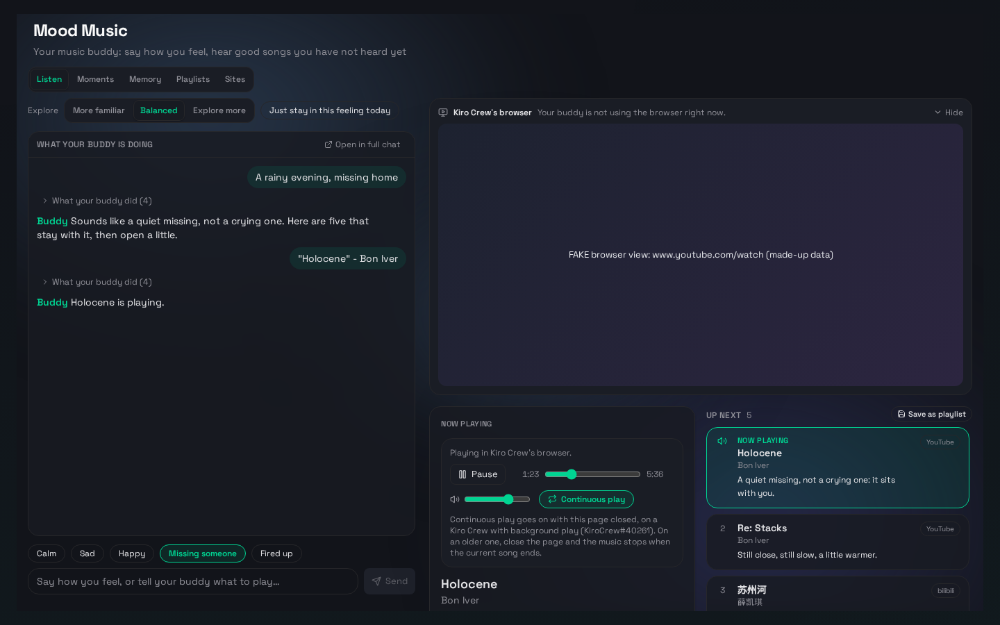
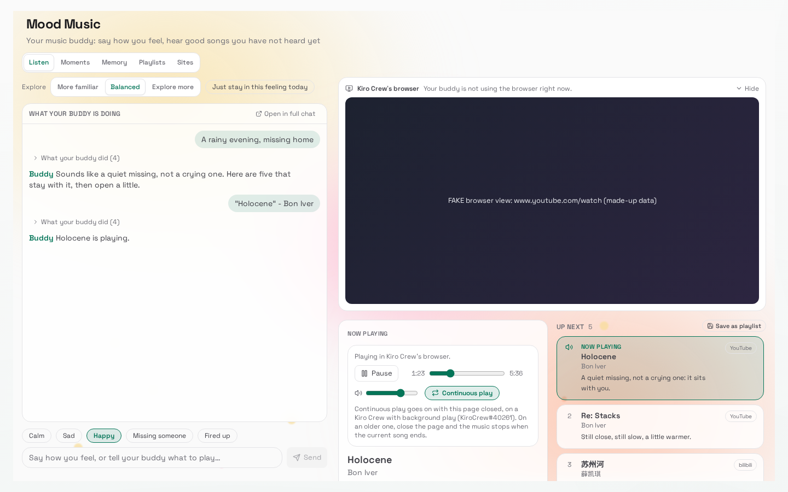
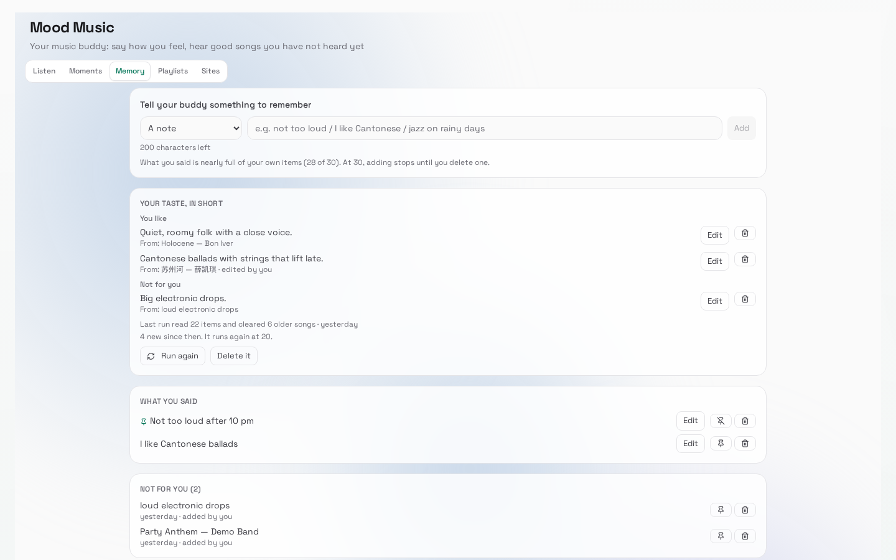
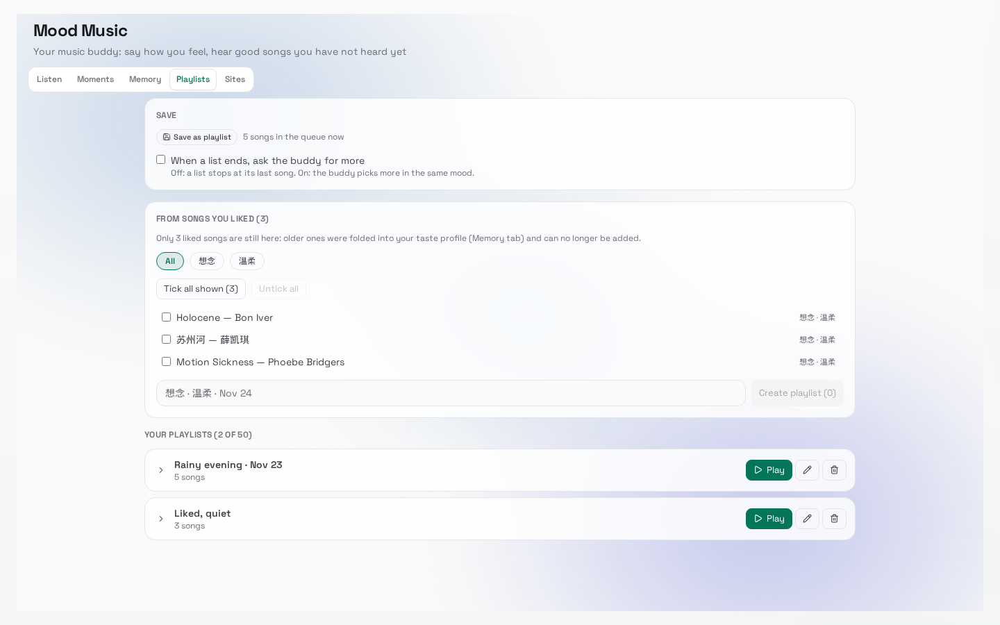
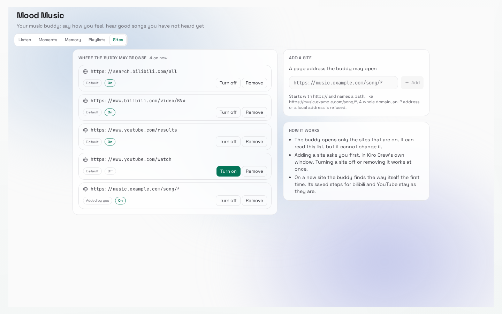

# Mood Music

<picture>
  <source media="(prefers-color-scheme: dark)" srcset="docs/media/hero-dark.png">
  
</picture>

**Say how you feel, and hear songs that feel the same.**

Mood Music is an app for [Kiro Crew](https://github.com/kirodotdev/KiroCrew),
the open-source personal AI agent.

## What it is

Mood Music adds a **Mood Music** page to Kiro Crew. You tell your music buddy how
you feel, or name a song that moved you. The buddy searches reviews and lists for
good songs most people have not heard yet, says why each one fits and what to listen
for, and orders them from staying with the feeling to lifting it a little. You see
what it is doing while it works. Songs play in Kiro Crew's own browser: press play,
and the buddy finds the song on YouTube or bilibili there and starts it. A
**Memory** tab shows what the buddy knows about your taste, and you decide what
stays.

**Get started:** open **Apps → Discover**, find **Mood Music**, choose **Install**,
then **Enable**. See [Install](#install) for the details.

## The problem it solves

Music apps pick songs from your history and from genres. They do not ask how you
feel. When one song hits you hard, there is no simple way to say "more of this
feeling" and to hear why each song was picked. Mood Music starts from the feeling,
and it remembers what you liked and skipped so the next picks get closer. It never
signs in to any music site and never plays, likes or comments anything for you.

## Top 3 use cases

### 1. Find songs for a mood

It is a rainy evening and you miss home. You click **Missing someone**, or type it
in your own words. A moment later a song is ready to play, with a short line on why
it fits, and more songs wait under **Up next**. Click **Like** on the ones that land.
**Like** and **Skip** work any time a song plays, even while the buddy is still working.

You can type while the buddy is still working. Your words go into what it is doing
right now, marked **Cut in** in the conversation, and its answer brings songs as
usual. If the buddy could not take them in, the page says so and leaves your words
in the box; nothing waits in a line to be sent later.


### 2. Let the buddy play songs in Kiro Crew's browser

Choose **Find and play** (or a song's play button), and the buddy searches for it on
bilibili or YouTube in Kiro Crew's own browser and opens the video. That is the same
browser your chats use; on a Mac it is your own Chrome, with your sign-ins and your
sound. The buddy plays every song in one tab of its own. **Play**, **Pause**, the
progress bar and the volume act on that tab at once; they never wait for the buddy.
**Continuous play** is on from the start: when a song ends the buddy plays the next
one, adding songs for the same mood when the list runs low, until you press
**Pause**. A song that ends while the buddy is busy with something else plays the
next one as soon as the buddy is done. Pressing play on the video site itself after
a pause here counts as play. Turn it off and the page remembers. Click **More like this** to get songs
close to the one you are hearing.

The first time, approve the music sites on the app's page (**Approve the sites**
takes you there). By default Mood Music may only open bilibili and YouTube search
and video pages; the **Sites** tab changes that list (see How to use it). Continuous play goes on with the Mood Music page closed, on a Kiro Crew that
tells the app when a song ends (KiroCrew#40261): the app wakes the buddy once for the
next song, and asks for more when the list runs low. **Pause** and turning continuous
play off hold there too. On an older Kiro Crew it works only while the page is open:
close it and the music stops when the current song ends.

Above the player, **Kiro Crew's browser** shows the buddy's browser tab live, the same
picture a chat shows under a browser step. The line beside it says **Using the
browser…** while the buddy searches and opens the song. Choose **Take over** to use
the tab yourself and **Hand back** when you are done; **Hide** folds the box away and
the page remembers. When the buddy finishes, the box folds the way a chat's browser
card does: it shows **Show the live page**, and one click streams the tab again. This needs a Kiro Crew with the app browser view (KiroCrew#39246,
#39018, #39020), **App browser access** on in **Settings → Feature Previews**, and
**view** approved on the app's page. On an older Kiro Crew the box says to update.



<sub>This picture and the one at the top were drawn from the page with made-up songs
and a made-up browser-tab state (playing, 1:23 of 5:36); the browser box is a labelled
placeholder, and no real browser tab or model was used.</sub>

### 3. Look back at your moments

Every mood you share is kept on the **Moments** tab, with the time and the songs it
brought. It is a small diary of what you felt and what you listened to.


The background colour and its slow drift follow the mood, in light and dark:




## Watch it


[Watch the walkthrough as a video (MP4)](docs/media/walkthrough.mp4).

<sub>Recorded from the Mood Music page drawn with Kiro Crew's own dashboard styles on
made-up demo data. No AI model was connected, so no buddy reply is generated in the
recording: it moves across the tabs to show the current layout (Listen, Moments,
Playlists, Memory, Sites). The browser box is a labelled placeholder, and the player
shows a made-up position over a still frame.</sub>

## Install

**From the Kiro Crew App Store**

1. In Kiro Crew, open **Apps → Discover** in the left sidebar.
2. Search for **Mood Music** and choose **Install**.
3. Kiro Crew asks **Trust “Mood Music” to run its own code?** The app runs a small
   piece of code that saves your moods and likes on your computer. Trusting it gives
   that code the same access Kiro Crew has (your files, your saved sign-ins and the
   internet), as the dialog says. Choose **Trust this app**. You can take it back
   later in **Settings → Security → Third-party apps**.
4. The app installs switched off. Choose **Enable and allow chat control** on its
   page, so the buddy can ask you on the Mood Music page before it opens a web page
   it was not already allowed to. It then shows up under **Apps** in the sidebar and
   in **Apps → Library**.

Kiro Crew must already be able to chat: if ordinary chats work, this works. No music
account or key is needed. Playing songs needs a Kiro Crew that lets apps name the
browser pages their agent may open (KiroCrew#38333, newer than v0.13.0-rc.3). On an
older Kiro Crew the page says so in the player's place and offers no play button;
finding songs, Moments and Memory still work.

### What Kiro Crew it needs

The app degrades part by part on an older Kiro Crew, and says on the page which part
is missing. Each feature below names the Kiro Crew change it needs. All of these are
merged on kirodotdev/KiroCrew; use a Kiro Crew build that includes them (newer than
v0.13.1).

| Feature | Needs | Merged |
|---|---|---|
| Play songs in Kiro Crew's browser (approved sites) | [KiroCrew#38333](https://github.com/kirodotdev/KiroCrew/pull/38333) | yes |
| The buddy's hidden chat on the page | [KiroCrew#39246](https://github.com/kirodotdev/KiroCrew/pull/39246) | yes |
| App browser access, the `browser` grant and the live **view** | [KiroCrew#39018](https://github.com/kirodotdev/KiroCrew/pull/39018) | yes |
| The live view keeps the picture after a turn | [KiroCrew#39943](https://github.com/kirodotdev/KiroCrew/pull/39943) | yes |
| Continuous play with the page closed (song-end signal) | [KiroCrew#40261](https://github.com/kirodotdev/KiroCrew/pull/40261) | yes |
| One calm consent notice on a fresh install | [KiroCrew#40252](https://github.com/kirodotdev/KiroCrew/pull/40252) | yes |
| The view shows the page again right after playback resumes | [KiroCrew#40679](https://github.com/kirodotdev/KiroCrew/pull/40679) | yes |
| A media ending takes its source from the right site | [KiroCrew#40726](https://github.com/kirodotdev/KiroCrew/pull/40726) | yes |
| The owner adds, removes and turns off sites (the **Sites** tab) | [KiroCrew#40727](https://github.com/kirodotdev/KiroCrew/pull/40727) | yes |

Two parts need the newest of these: the **Sites** tab needs KiroCrew#40727, and
continuous play with the Mood Music page closed needs KiroCrew#40261. On a Kiro Crew
without them the Sites tab says to update, and continuous play works only while the
page is open.

### Not yet shipped

Browser **operation recipes** (fixed clicks Kiro Crew runs on the tab on its own,
including skipping an ad before a song) are still in progress in
[KiroCrew#41783](https://github.com/kirodotdev/KiroCrew/pull/41783), which is not
merged. Mood Music does not use them yet: the buddy opens and plays each song itself,
and there is no automatic ad-skip.

## First run

The page opens with a short hello from the buddy and an empty player. Type a
feeling or a song name in the box and choose **Send**; a mood chip fills the box for
you. On a wide window the buddy's record and the box are on the left, and the
browser, the player and **Up next** are on the right; on a narrow one they stack. The conversation stays
on this page; it is not listed in Kiro Crew's sessions.

## How to use it

1. Open **Mood Music** in the sidebar.
2. Choose how far to explore: **More familiar**, **Balanced** (one song you may
   know and four new ones) or **Explore more**. To stay with a feeling, turn on
   **Just stay in this feeling today**.
3. Use the one box at the bottom left for everything: how you feel ("this one makes
   me cry"), a song that moved you, or what to play ("next", "play it again",
   "something in Cantonese", "play Suzhou River"). Choose **Send**. A mood chip
   such as **Calm** or **Missing someone** puts its mood in the box for you. When
   the buddy asks you a question, the box answers it. **Stop** cancels a reply.
   If the buddy reads an ask to play, pause or skip, the page does it in the player.
4. The left column is the buddy's record, always open: what you said, the steps
   it takes in plain words ("Searched the web", "Read a page", "Opened a page",
   "Clicked"), the short notes it writes on the way, and its reply. While the buddy
   works, its newest five steps show; when it is done, they fold into one row
   (**What your buddy did**) that opens to show them all. The newest is at the
   bottom and the record follows it, unless you scroll up to read back; **Latest**
   takes you down again, and says **New message** when the buddy wrote while you
   were up. **Open in full chat** shows the same conversation with every search and
   page the buddy used.
5. Each song card says why it is here, what to listen for and who praised it. Choose
   **Play**, the heart to like it, skip, or **I know it**. Tap a suggestion under the
   reply to keep talking, or **Remember: ...** to save a preference the buddy heard.
6. **Up next** lists every song with its artist and why it was picked; the one
   playing says **Now playing**. Click any song to play it now, even while the buddy
   is still working: it drops what it was doing and plays that song. Pause, play, the
   progress bar and the volume act on the browser at once; they do not ask the buddy.
7. Open **Memory** to see your own notes and the songs and moods the app recorded.
   Add, edit, pin or delete any of them; **Clear everything out of date** removes
   what the app recorded and has not used for 90 days. What you wrote yourself is
   never removed for you. Add a **Not for me** item too: a song, or a few words like
   "太吵的电子". The tab says plainly when a list is nearly full, or full of your own
   and pinned items (then adding stops with a message until you delete one).
   **Your taste, in short** at the top is written in the background after about 20
   new likes, skips or "not for me" items: a few lines of what you like and what is
   not for you, each naming the songs it came from. Edit a line and it is yours (a
   later run never changes it), delete a line or the whole summary, or press **Run
   again**. After a run, older songs the app recorded are cleared, except the 5
   newest of each kind, pinned ones and the ones a line names; the buddy still never
   offers a cleared song as new.

   
8. Open **Moments** to see the moods you shared and the songs they brought.
9. Keep songs as playlists. **Save as playlist** in the **Up next** header saves the
   queue in one press, named by the mood and the date. On the **Playlists** tab, make
   one from songs you liked: all of them, the ones a mood word shows, or the ones you
   tick. Open a list to see its songs and remove one, rename it, delete it, or
   **Play** it. Playing a list replaces the queue and plays through it in order.
   When it ends, it stops, unless you turn on **When a list ends, ask the buddy for
   more**. You can keep 50 lists of up to 200 songs each. Once the taste profile has
   folded older likes away, only the liked songs still in Memory can be picked, and
   the tab says so.

   
10. Choose where the buddy may browse on the **Sites** tab. It lists every site,
   whether it is a default (from the app) or one you added, and whether it is on,
   waiting for approval, off or removed. **Add** a page address (`https://` and a
   path, such as `https://music.example.com/song/*`): Kiro Crew asks you in its own
   window first, and says why when it refuses one (a whole domain, an IP address or a
   local address). **Turn off** and **Remove** work at once, for the defaults too,
   and **Add back** or **Turn on** asks again. The buddy reads this list with every
   play but cannot change it. On a new site it finds the way itself; its saved steps
   for bilibili and YouTube stay. This needs a Kiro Crew with owner site edits
   (KiroCrew#40727); an older one shows **Update Kiro Crew** on the tab.

   
11. The background follows the mood. A chip sets its scene at once. The buddy
   picks a new scene only when your mood clearly shifts, and the scene drifts
   toward its brighter colour as the songs move from stay to lift. To stop the
   background moving, choose **Pause background motion** at the top
   right. It pauses only the background, never the music.

## Settings & data

- **Where your data lives:** `~/.kiro/crew/apps/mood-music/data/state.json` (or under
  `$KIROCREW_HOME` if you set it). It holds your moods, the current list, your likes
  and skips, and the Memory tab. Your playlists are in `playlists.json` next to it.
- **What leaves your computer:** your mood text and a short summary of your memory
  (your notes and "not for me" items, the taste summary, a few songs you liked or
  skipped, songs you know, recent moods) go to the AI model
  Kiro Crew uses, so the buddy can pick. To write the taste summary, the list of
  songs you liked, skipped or marked "not for me" goes to the same model, in a
  hidden chat of its own with no tools. The buddy searches the public web. To check
  song link the buddy gives, the app asks `www.youtube.com/oembed` or
  `api.bilibili.com` about that one video, with no cookie. Songs play on YouTube or
  bilibili in Kiro Crew's browser. Since 0.2.6 the buddy's chat is opened by the app
  with Kiro Crew's usual memory setting, so Kiro Crew's memory may learn from it as
  from any of your chats (before 0.2.6 it was a temporary chat that wrote no memory).
- **Crew Browser:** the buddy types and clicks in Kiro Crew's browser, which may be
  your own signed-in Chrome. Kiro Crew holds it to four kinds of page:
  `search.bilibili.com/all`, `www.bilibili.com/video/BV…`, `www.youtube.com/results`
  and `www.youtube.com/watch`. Its instructions forbid account pages, comments, likes,
  coins and payments, but those are rules it follows, not a block Kiro Crew enforces
  on those pages. Mood Music keeps, per site, the steps that last played a song (for
  example "open the search page, open the matching video in the same tab") in `state.json`,
  and sends them back to the buddy next time. If they fail, it forgets them and the
  buddy finds the way again.
- **The buddy's chat:** the app opens it itself (chat slots, at the trust prompt)
  and keeps it out of Kiro Crew's session lists (hidden sessions). Open it with
  **Open in full chat** on the page. Since 0.2.6 it is a new chat; the one from
  0.2.3 to 0.2.5 and the listed one from before 0.2.3 are left as they were. Mood
  Music no longer uses them and never deletes them, so close or delete them
  yourself when you like. If Kiro Crew is too old to open a hidden chat for an app,
  the page says to update it; it never opens a listed chat instead.
- **The live browser view:** only you see it, on this page. The buddy cannot read
  it, and the app asks for **view** only, never to read or act on the page itself.
- **Turn it off:** **Apps → Library**, open the **⋯** menu on Mood Music, choose
  **Disable**. Your data is kept.
- **Remove it:** the same menu, **Uninstall**. **Keep app data** is ticked by
  default; untick it to delete the data too.

## Troubleshooting / FAQ

**I see "Couldn't read your buddy's answer" or "Something went wrong this time".**
Choose **Ask again** or **Try again**. The record on the left shows what the buddy
did; **Open in full chat** shows every search and page.

**I see "Your buddy seems stuck".**
Nothing moved for two minutes. Choose **Wait a bit more**, or **Stop and start
over**. Check that an ordinary chat in Kiro Crew still answers.

**A message says some songs were left out, or none of them could play.**
When the buddy gives a song's link, the app asks YouTube or bilibili about it before
showing the song, and drops one that they say does not exist or whose title does not
match. When they cannot be asked (for example, bilibili refuses the check from some
networks, or the check times out), the song stays and its card says **Not verified**.
A song with no link is kept: the buddy finds it on its site when you press play. Try
another direction.

**The player says "Songs cannot play in Kiro Crew's browser yet".**
The note says why. Your Kiro Crew is too old (update it to a version newer than
v0.13.0-rc.3 that includes KiroCrew#38333, then open the page again), the sites are
not approved yet (choose **Approve the sites**), or a policy turns Kiro Crew's
browser off. There is no play button until then.

**The buddy says it could not play a song.**
Its reason shows under the chat. Press play again: it finds the way afresh.

**Can it play Spotify or Apple Music?**
No. It plays YouTube and bilibili songs in Kiro Crew's browser.

## Development

### Layout

| Path | What it is |
|---|---|
| `app.json` | The manifest: page, agent, skill, backend hook, `permissions.chatSlots`, `hiddenSessions`, `browserSites` and `browser: ["view"]` |
| `agents/taste.json` | The taste summarizer (no tools): `backend/taste.py` opens it in a fresh hidden chat for each run, then closes that chat |
| `agents/dj.json`, `skills/mood-music/` | The music buddy agent (`web_search` and `web_fetch`, both run without asking, and Kiro Crew's `browser` on the approved `permissions.browserSites` pages) and its reply contract; the page also sends the contract and a bounded memory summary with every request (`ui/src/request.prompt.ts`). It pins no model, so it runs on your default |
| `backend/` | Routes (`hooks.routes`), the buddy's hidden chat through `ctx.chat_slots` (`buddy.py`), the JSON store with memory, the link checks, `playlists.py` (saved playlists, in their own file) and `verify.py` (the YouTube oEmbed / bilibili view lookups) |
| `ui/src/`, `ui/dist/index.mjs` | The page, and its committed ESM bundle |
| `ui/i18n/` | The app's strings in 12 languages |
| `tests/`, `ui/tests/` | Backend and UI tests |

The page frames nothing: songs play only in Kiro Crew's browser, on the four pages
`permissions.browserSites` names plus the ones the owner added on the **Sites** tab
(`useBrowserSites`, App Kit level 13; the backend reads the same list with its app
token, `backend/sites.py`, and never changes it), and the page's buttons reach that tab through
`useBrowserMedia` (App Kit level 10). The live view is the host's `BrowserView`
(level 11), shown only for the buddy's own chat, which the backend opens with
`ctx.chat_slots.open(state, key, hidden=True)` so it carries the app's name; the
media route, the approved sites and the view all key off that name. A pick names
its site; a link is optional.
A YouTube link keeps only its 11-character video id, which the page and the backend
both check; a bilibili link must be `https` on exactly `www.bilibili.com`,
`m.bilibili.com` or `b23.tv`.

### Install from a clone

```bash
git clone https://github.com/iamwhatever/kirocrew-app-mood-music
kirocrew app install ./kirocrew-app-mood-music
kirocrew app enable mood-music
```

`kirocrew app enable` is refused with `app_execution_denied` until the app is
trusted, and there is no command-line trust step. Enable it from **Apps → Library**
instead: that opens the trust dialog, and **Trust this app and enable** does both.
`kirocrew app disable mood-music` turns it off;
`kirocrew app uninstall mood-music` keeps the data and adding `--purge-data`
deletes it.

### Tests

```bash
python -m pip install -r tests/requirements.txt
python -m pytest
cd ui && npm ci && npm run typecheck && npm test && npm run build
```

CI fails if `ui/dist/` differs from a fresh build.

### Re-capture the README media

The pictures and the recording above were drawn from the real page source with
made-up data and a stand-in host (the browser box is a labelled placeholder and no
model was connected); `docs/media/media.json` records the app and Kiro Crew commits.
[`capture/`](capture/README.md) holds the template's harness for a real, isolated
Kiro Crew gateway, the supported way to refresh the media:

```bash
python capture/capture.py --kirocrew /path/to/KiroCrew
python capture/check_readme.py
```

Then look at every image and at a few frames of the video before committing
(see [CHECKLIST.md](CHECKLIST.md)).

## License

Apache License 2.0. See [LICENSE](LICENSE) and [NOTICE](NOTICE).
